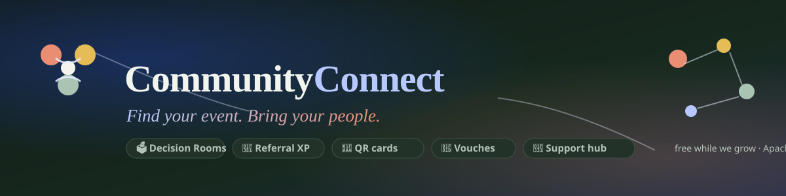

<p align="center">
  
</p>

<h1 align="center">CommunityConnect</h1>

<p align="center">
  <a href="https://siddhant-pardeshi.github.io/communityconnect/">Live app</a> ·
  <a href="docs/ARCHITECTURE.md">Architecture</a> ·
  <a href="PROJECT_STATUS.md">Status</a> ·
  <a href="marketing/CommunityConnect-User-Walkthrough.pdf">Walkthrough</a> ·
  <a href="docs/LAUNCH_PLAYBOOK.md">Launch playbook</a> ·
  <a href="CODE_OF_CONDUCT.md">Conduct</a>
</p>

<p align="center">
  <a href="#license"></a>
  <a href="https://siddhant-pardeshi.github.io/communityconnect/"></a>
  
  
</p>

---

A group chat has three event links and no decision. CommunityConnect turns those links into one
plan: a circle votes can/maybe/cannot before a deadline, clashes surface on their own, and a single
event gets confirmed — with a buddy if someone wants company.

It is free while the platform grows. Planning, voting, buddy matching, connections, safety tools
and the networking card cost nothing, and they stay free by policy.

## The loop

```
discover / post  →  shortlist in a circle  →  vote  →  finalize  →  confirm  →  attend  →  vouch  →  repeat
```

- **Decision Rooms** — hard deadline enforced, 60% quorum, a published scoring formula
  (`100 × (0.65·can + 0.15·maybe + 0.20·favorite) / roster`), honest ties, no vote ever visible
  before close, one plan that needs two independent confirmations.
- **Circles** — private rooms, revocable invite codes, circle-only events that never leak into
  public search or share previews.
- **Peer vouches** — after an event, participants give hearts, verify each other's
  college/company/course claims, and record polite/professional conduct. Vouches count for a
  rolling 14 days, then fade: records renew and conduct can improve.
- **Referrals** — a join through your link pays both sides XP and boosts. Joins through
  founder-team links create *Founding Members* with permanent perks.
- **Networking card** — a printable 85.6 × 54 mm card with a QR to your live profile; privacy
  settings respected everywhere, including in print.
- **Founder console** — the founder and two co-founders see live platform telemetry, an invite
  leaderboard (who brought whom), a pulse feed, and an audited admin surface.

## Try it

Open [the live app](https://siddhant-pardeshi.github.io/communityconnect/) and use a demo profile
(Founder view / Aarav / Meera / Ananya) — no signup. The demo dataset is fictional and labeled.

## Development

```bash
npm install         # workspaces: @cc/core + @cc/web
npm run dev         # http://localhost:5173
npm test            # 27 unit tests across workspaces
npm run build       # typecheck (both) + production build
```

| Path | What lives there |
|---|---|
| `packages/core` | Pure domain: types, XP/scoring/trust/role rules, time & .ics math, seed — no React, no DOM |
| `apps/web` | React SPA: store (single mutation point), 25 screens, design system, PWA shell |
| `marketing/` | Print-ready flyer PDF, founder's manual PDF, QR codes, social banners, build scripts |
| `docs/` | Architecture, ADRs, acceptance matrix, launch playbook, business model, brand shortlist |
| `AI_MASTER_CONTEXT.txt` | One-file project brief — the full architecture, rules and runbook, written so any AI tool (or new engineer) can continue the project with zero context loss |

Dependency direction is one-way: `@cc/core` imports nothing from the app, so a server backend can
reuse every rule unchanged. The store (`apps/web/src/lib/store.ts`) is the single swap point — see
[docs/DECISIONS.md](docs/DECISIONS.md).

## Current scope, stated plainly

Accounts and data live **per browser** in this release; the demo auth is salted-and-hashed local
storage. Multi-device sync, server-side auth, and email are the next milestone (Supabase swap,
schema mapping already written). "CommunityConnect" is a working name — not yet trademark-cleared.

## Deployment

The live site deploys from the `gh-pages` branch. GitHub Actions workflows for CI + Pages are in
`.github/workflows/` and go live once the maintainer's token carries the `workflow` scope (one
command, documented in [PROJECT_STATUS.md](PROJECT_STATUS.md)). Any static host works:
`npm run build` and serve `apps/web/dist`.

## License

Apache-2.0. See [LICENSE](LICENSE) and the conduct policy that governs the product itself.
